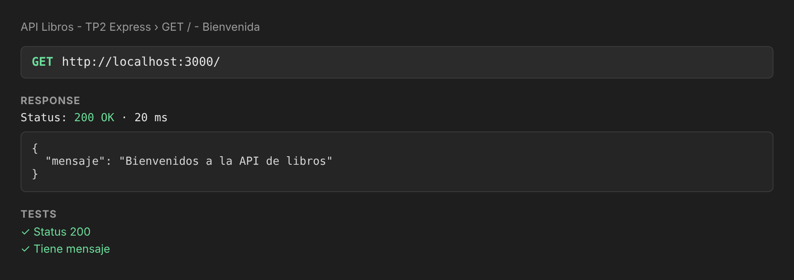
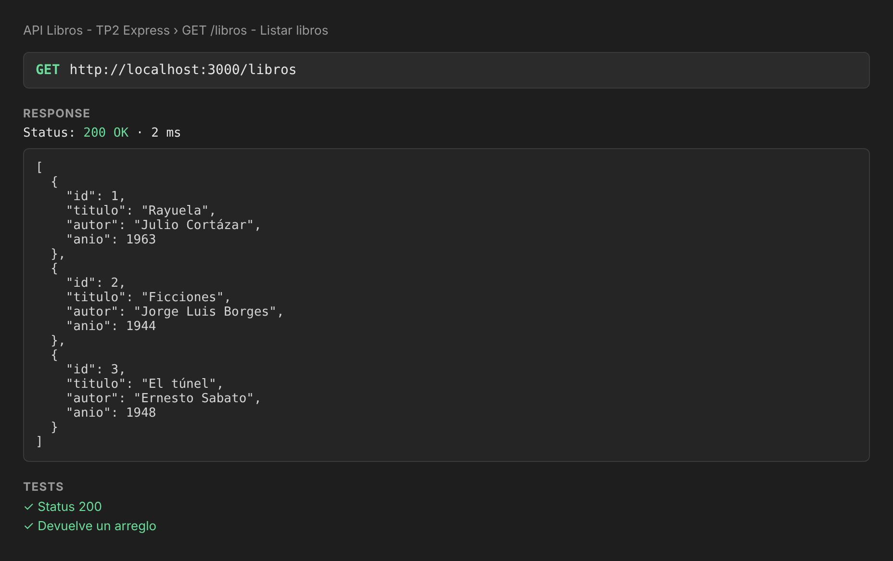
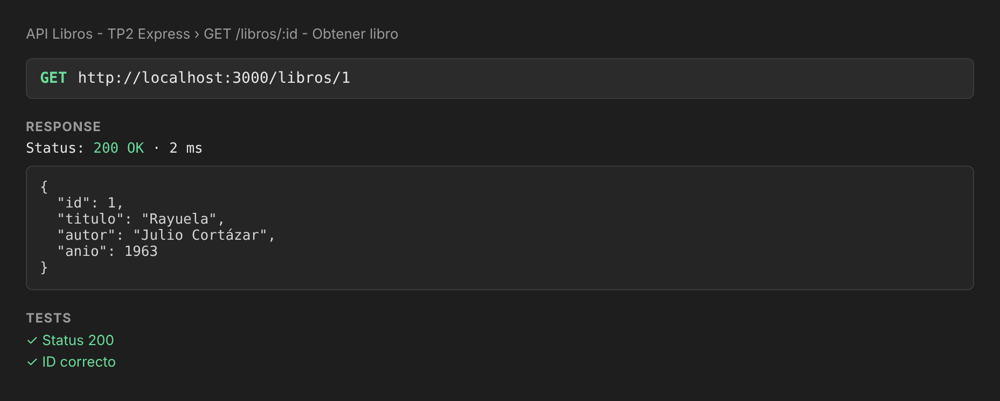
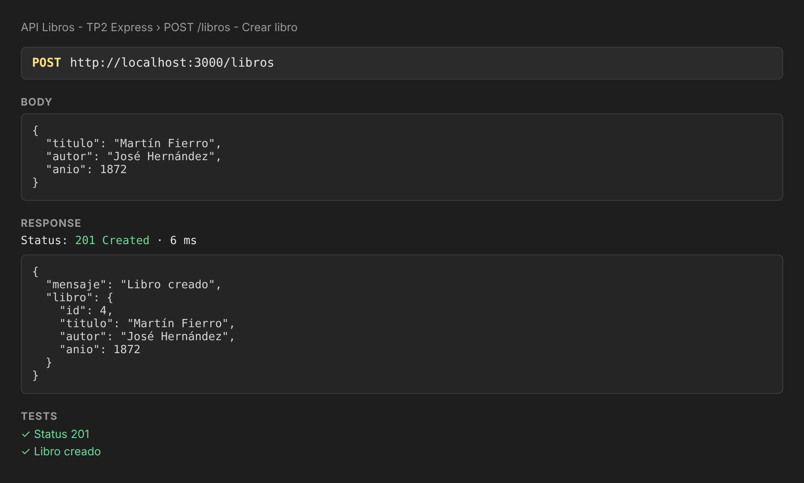
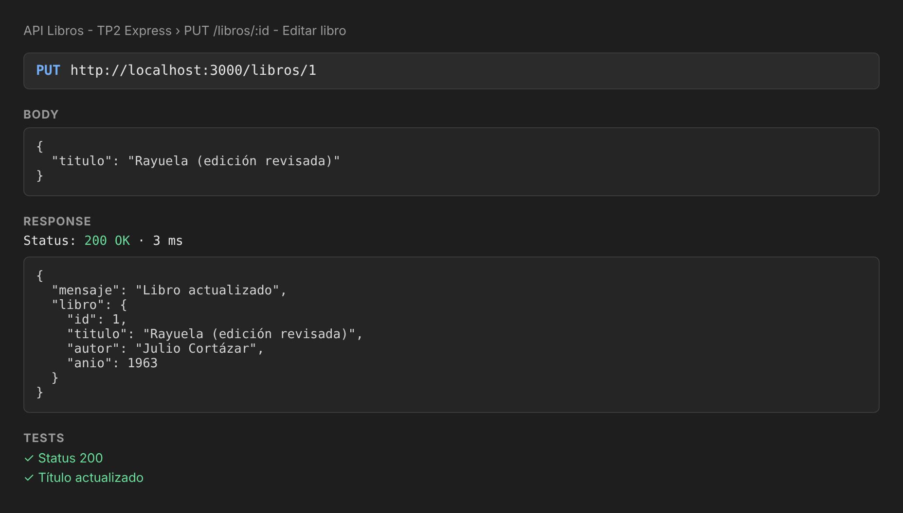
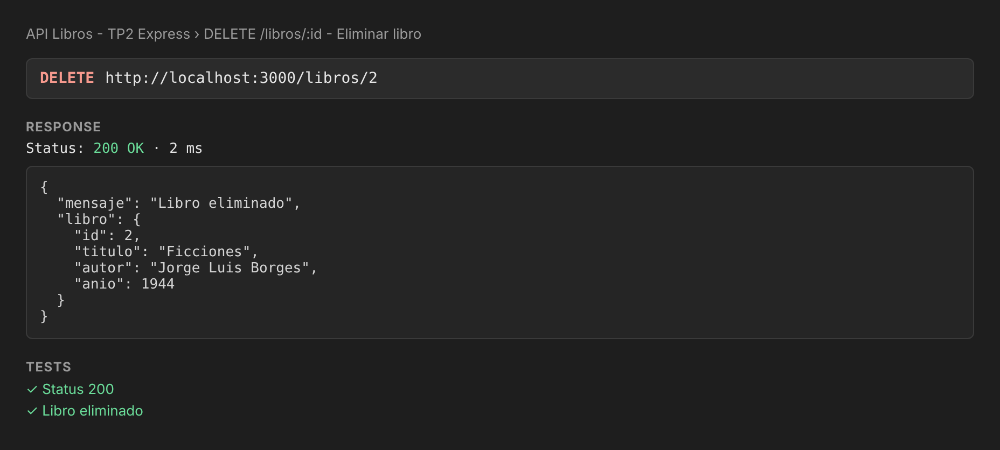
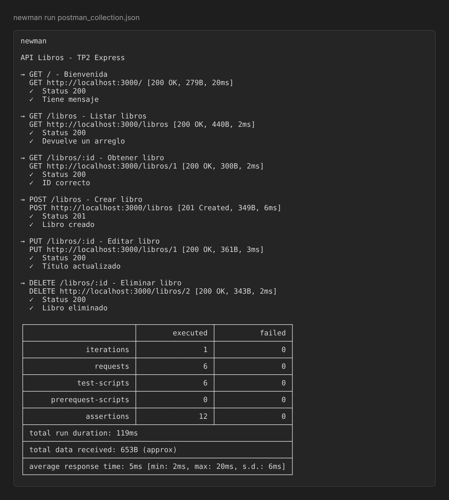

# API REST de Libros con Express

API REST sencilla hecha con Node.js y Express que expone un CRUD de libros. Los datos se guardan en memoria, así que se reinician cada vez que se levanta el servidor.

## Instalación y ejecución

```bash
git clone https://github.com/candelacorradin/node-tp2.git
cd node-tp2
npm install
node server.js
```

El servidor queda escuchando en `http://localhost:3000`.

## Rutas

| Método | Ruta          | Descripción                |
| ------ | ------------- | -------------------------- |
| GET    | `/`           | Mensaje de bienvenida      |
| GET    | `/libros`     | Lista todos los libros     |
| GET    | `/libros/:id` | Devuelve un libro por ID   |
| POST   | `/libros`     | Crea un libro              |
| PUT    | `/libros/:id` | Edita un libro             |
| DELETE | `/libros/:id` | Elimina un libro           |

Ejemplo de body para `POST` / `PUT`:

```json
{
  "titulo": "Martín Fierro",
  "autor": "José Hernández",
  "anio": 1872
}
```

## Pruebas con Postman

La colección está en `postman_collection.json` (se importa desde Postman con **Import**). Incluye las 6 solicitudes con tests que validan el status y el contenido de cada respuesta.

Las capturas de las pruebas están en la carpeta [`capturas/`](./capturas):

| Solicitud | Captura |
| --------- | ------- |
| GET `/` |  |
| GET `/libros` |  |
| GET `/libros/:id` |  |
| POST `/libros` |  |
| PUT `/libros/:id` |  |
| DELETE `/libros/:id` |  |
| Resumen de la ejecución |  |

## Autora

- **Estudiante:** Candela Corradin
- **Curso:** Diplomatura Full Stack — Centro de e-Learning UTN BA
- **Unidad:** Módulo 1 - Unidad 2 · Mi primera API REST con Express
